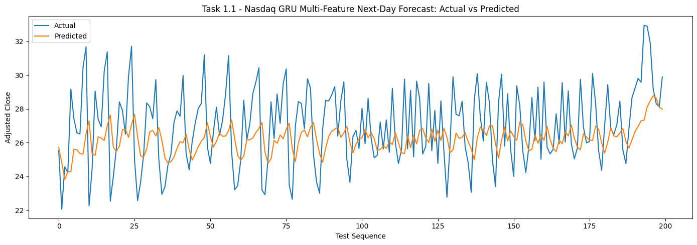
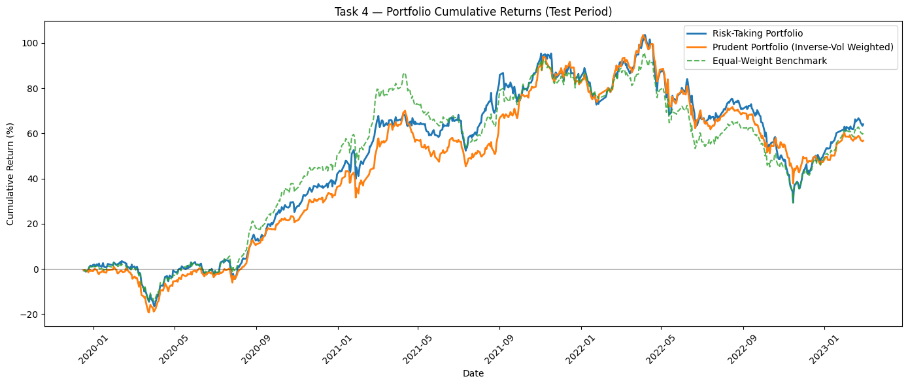

# Deep Learning for Financial Time Series and Portfolio Construction

An empirical study of recurrent neural networks for equity forecasting, trading-signal classification, and portfolio allocation using Nasdaq and Vietnamese stock-market data.

Originally developed for **CS313 Deep Learning**, this project connects data preparation, GRU modeling, financial evaluation, and a local inference prototype. Its central finding is that price-forecast accuracy, directional performance, and portfolio outcomes must be assessed separately: improvements in one measure do not establish a useful trading strategy.

**Author / repository owner:** [miracl-3](https://github.com/miracl-3)

**Status:** Coursework completed in May 2026; documentation revised on 18 October 2026. Results below summarize the original saved notebook outputs. Models have not been retrained for this documentation update.

[Research questions](#research-questions) · [Methodology](#methodology) · [Results](#results-and-interpretation) · [Limitations](#limitations) · [Repository guide](#repository-guide) · [Getting started](#getting-started)

**Start here:** [Project report](230070-project-report.pdf) · [Main notebook](230070_project_notebook.ipynb) · [Research and evaluation notes](docs/research-notes.md)

## Research questions

1. How do GRU models perform on next-observation and three-observation equity price forecasts across two markets?
2. Do price-forecast improvements also produce reliable directional predictions and buy/sell classifications?
3. How do predicted-return and inverse-volatility allocations compare with an equal-weight portfolio in the historical illustration?

## Methodology

| Component | Implementation |
| --- | --- |
| Market data | Historical CSV datasets under `data/nasdaq/` and `data/vn_dataset/`; selected forecasting examples are `GT` and `VCB`. |
| Price features | OHLCV, adjusted close where available, log returns, 10- and 20-observation moving averages, and rolling volatility. |
| Price models | GRU forecasters with a 30-observation lookback; next-observation, third-observation, and three-output forecasts. |
| Experimental design | Chronological 70% / 15% / 15% train / validation / test blocks, training-fitted scalers, early stopping, and time-series cross-validation on the pre-test block. |
| Forecast benchmarks | Persistence forecasts using the preceding observed price; a separate test-mean diagnostic is discussed in the research notes. |
| Signal classification | GRU classifiers for Vietnamese buy and sell labels, evaluated with precision, recall, F1, ROC AUC, and precision-recall metrics. |
| Portfolio allocation | A shared return model across 40 Vietnamese stocks, a 60-observation lookback, a 20-observation target horizon, risk scoring, and eight-stock allocations. A separate mean-variance example is also included. |
| Inference prototype | Saved Keras models and scalers served by FastAPI, with a Streamlit interface for selected forecasts and stored portfolio outputs. |

The original assignment labels, **Tasks 1–5**, are retained in the notebook and API. They map to Nasdaq forecasting, Vietnamese forecasting, signal classification, portfolio construction, and deployment, respectively.

## Results and interpretation

These values are rounded from the notebook's saved outputs. They have not been independently reproduced in a fresh environment. Price errors use each dataset's original target units, so RMSE should be compared within a market.

### Next-observation price forecasts

| Market / ticker | Model | RMSE | sMAPE (%) | R² | Directional accuracy (%) |
| --- | --- | ---: | ---: | ---: | ---: |
| Nasdaq / GT | GRU | 3.035 | 13.10 | 0.836 | 42.31 |
| Nasdaq / GT | Persistence | 3.467 | 13.58 | 0.786 | 46.89 |
| Vietnam / VCB | GRU | 4,979.200 | 5.53 | 0.229 | 44.20 |
| Vietnam / VCB | Persistence | 1,409.475 | 1.31 | 0.938 | 42.83 |

The Nasdaq GRU improves RMSE and sMAPE over persistence, while its reported directional accuracy is lower. For VCB, persistence is substantially stronger on price error. The results support evaluating model complexity against simple forecasts rather than assuming that a neural model is preferable.



*Original notebook plot, showing the first 200 test sequences for Task 1.1. The horizontal axis indexes sequences rather than calendar dates. "Directional accuracy" in the table compares changes between successive predicted prices with changes between successive actual prices; it is not a trading hit rate.*

### Trading-signal classification

| Signal | Precision | Recall | F1 | ROC AUC |
| --- | ---: | ---: | ---: | ---: |
| Buy | 0.310 | 0.530 | 0.391 | 0.464 |
| Sell | 0.358 | 0.623 | 0.455 | 0.551 |

Discrimination is weak in these saved experiments. The classifiers remain part of the research notebook and are not exposed by the local inference service. A small difference from a benchmark does not, on its own, demonstrate statistically reliable predictive value.

### Portfolio allocation: retrospective illustration

**Evaluation qualification:** the notebook constructs allocations from end-of-sample forecasts and risk scores, then applies those weights to an earlier historical period. This introduces look-ahead bias. The following comparison is a retrospective illustration of the allocation mechanics, rather than a valid out-of-sample strategy backtest.

| Allocation | Total return (%) | Reported Sharpe | Maximum drawdown (%) |
| --- | ---: | ---: | ---: |
| Predicted-return weighted ("Risk-Taking") | 64.04 | 0.930 | -36.45 |
| Inverse-volatility weighted ("Prudent") | 56.77 | 0.936 | -32.29 |
| Equal-weight selected-stock benchmark | 60.14 | 0.964 | -33.94 |



*Saved comparison over 798 observations, starting 16 December 2019. The original plot says "Test Period"; the timing limitation above applies to every series. The Sharpe calculation assumes a zero risk-free rate, and trading costs are excluded. The equal-weight comparator contains eight selected stocks, not the whole market. See the [evaluation notes](docs/research-notes.md#portfolio-evaluation) for details.*

## Limitations

- **Information timing:** chronological model splits do not by themselves establish a point-in-time investment study. Universe screening uses full-sample information, and the portfolio illustration has the look-ahead issue described above.
- **Metric interpretation:** price-level R² and the notebook's directional metric do not establish profitable trading. Multi-output metrics flatten overlapping forecast windows.
- **Market realism:** transaction costs, slippage, execution constraints, and a full corporate-action and trading-calendar audit are outside the implemented evaluation.
- **Reproducibility:** dependencies are unpinned, and the original notebook contains Colab-specific paths that require configuration before a fresh run.
- **Scope:** the supplied price-prediction artifacts are specific to `GT` and `VCB`. The larger Airbyte / PostgreSQL / dbt / Airflow workflow is a documented design; the runnable prototype uses FastAPI and Streamlit.

The [research notes](docs/research-notes.md) document the recorded evidence, data provenance gaps, and methodological improvements that would be needed for a future study.

## Repository guide

```text
.
|-- README.md
|-- 230070_project_notebook.ipynb       # Original analysis and saved outputs
|-- 230070-project-report.pdf          # Original course report
|-- requirements.txt                  # Existing application/model dependencies
|-- docs/
|   `-- research-notes.md              # Methods, metric definitions, and limitations
|-- data/
|   |-- nasdaq/                       # Nasdaq historical CSVs
|   `-- vn_dataset/                   # Vietnamese historical and supplemental CSVs
|-- deployment/
|   |-- api/                          # FastAPI application and artifact fallback
|   |-- app/                          # Streamlit interface
|   |-- artifacts/                    # Models, scalers, metadata, portfolio CSVs
|   `-- docs/                         # Runbook, workflow design, schema, report draft
`-- figures/                          # Research plots and original demo screenshots
```

The original notebook and report filenames are retained for traceability. Empty local output folders are omitted from this guide.

## Getting started

### Environment

Python 3.11 is a suggested starting point, not a verified reconstruction of the original training environment. `requirements.txt` does not pin versions. JupyterLab and SciPy are included in the installation command because the notebook needs a notebook interface and uses SciPy for its mean-variance example.

```text
git clone https://github.com/miracl-3/Deep-Learning-for-Financial-Time-Series-and-Portfolio-Construction.git
cd Deep-Learning-for-Financial-Time-Series-and-Portfolio-Construction
python -m venv .venv
```

Activate the environment on Windows PowerShell:

```powershell
.\.venv\Scripts\Activate.ps1
```

Or on macOS / Linux:

```bash
source .venv/bin/activate
```

Install dependencies:

```text
python -m pip install -r requirements.txt jupyterlab scipy
```

### Inspect or rerun the notebook

The [notebook](230070_project_notebook.ipynb) can be inspected on GitHub without training. To work locally, launch `jupyter lab` from the repository root and open it there.

Before executing cells, configure the notebook's existing `PROJECT_DIR` for your checkout and `RAW_DATA_DIR` for its `data/` folder. The original notebook points to Google Drive and `data/raw/`; the committed datasets are directly under `data/nasdaq/` and `data/vn_dataset/`. Confirm the resolved paths before running the experiments. The [research notes](docs/research-notes.md#reproduction-notes) explain the remaining reproduction limits.

### Run the inference prototype

From the repository root, with the environment active:

```text
cd deployment
python -m uvicorn api.api_app:app --reload
```

Open [FastAPI documentation](http://127.0.0.1:8000/docs). In a second terminal at the repository root, activate the same environment and run:

```text
cd deployment
python -m streamlit run app/streamlit_app.py
```

Open the [Streamlit interface](http://localhost:8501). Saved artifacts support the selected next-observation models and stored portfolio tables; retraining is separate from serving those files.

| Endpoint | Purpose |
| --- | --- |
| `GET /health` | Service status |
| `GET /models` | Available artifact metadata |
| `POST /predict/task1` | GT next-observation price forecast |
| `POST /predict/task2` | VCB next-observation price forecast |
| `GET /portfolio/task4` | Stored portfolio outputs |

See the [deployment runbook](deployment/docs/task5_runbook.md) for sample requests and the [workflow design](deployment/docs/task5_workflow.md) for the proposed orchestration architecture. Sequence inputs require 30 rows with 10 features for GT or 9 for VCB; a one-row request is insufficient.

## Academic context and attribution

This repository preserves a CS313 coursework study maintained by [miracl-3](https://github.com/miracl-3). The course assignment brief remains in the first notebook cell, and the original report and task labels provide a record of the submission context.

The implementation covers preprocessing and sequence utilities, recurrent forecasting and classification, portfolio scoring and allocation, artifact export, and a local API/dashboard prototype. The original artifacts should be consulted for the work itself; this documentation update adds no model training or application functionality.

The upstream dataset providers, collection dates, and redistribution permissions are not established by the existing repository documentation. The files are described here as the supplied coursework datasets; no provider or data license is inferred.
